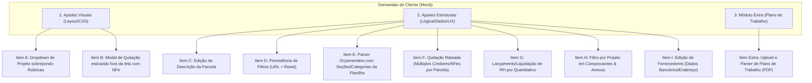
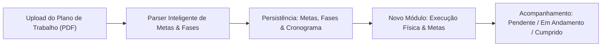

# Plano de Implementação: Correções & Evoluções do Sistema Moriá (MROSC)

---

## 1. Mapeamento Geral de Demandas do Cliente

Abaixo está a consolidação completa de todos os apontamentos, prints, gravações e áudios enviados pelo cliente, classificados formalmente entre **Alterações Visuais (Interface & Layout)**, **Alterações Estruturais & Funcionais (Regras de Negócio, Estado e Dados)** e a **Evolução Extra (Módulo de Plano de Trabalho)**.



### 1.1 Resumo dos Itens Mapeados

| ID | Tipo | Origem | Tela / Módulo | Resumo da Demanda do Cliente |
|---|---|---|---|---|
| **Item A** | Visual | Vídeo 1 | `Execução Financeira` | Dropdown de seleção de projetos com nome longo sobrepõe e tampa o botão vizinho *"Todas as Rubricas"*. |
| **Item B** | Visual | Print 2 | `Modal Quitar Parcela` | Ao anexar NFe com chave numérica extensa (44+ chars sem espaço), o modal quebra o grid, estica além da tela e esconde o botão verde *"Confirmar Quitação"*. |
| **Item C** | Estrutural | Print 1 | `Execução & Lembretes` | Permitir editar a descrição de uma parcela já criada (ex: renomear parcela para ajuste de competência). |
| **Item D** | Estrutural | Vídeo 4 | `Execução Financeira` | Filtros de Projeto e Rubrica somem ao clicar em "Voltar" no navegador. Requer persistência via URL + botão "Limpar Filtros". |
| **Item E** | Estrutural | Vídeo 2 | `Previsão Orçamentária` | Parser da planilha deve separar e agrupar as despesas pelas seções oficiais (RH, Encargos, Material Esportivo, Uniformes, Divulgação). |
| **Item F** | Estrutural | Vídeo 3 | `Quitação de Parcelas` | Parcelas agrupadas (ex: 3 Coordenadores de Núcleo) exigem rateio: múltiplos credores, valores, números de NFs e anexos na mesma obrigação. |
| **Item G** | Estrutural | Áudio 1 | `Execução de RH` | No RH, a liquidação deve ser por quantitativo pago vs previsto (ex: "Paguei 5 de 10 articuladores"), abatendo automaticamente o saldo unitário previsto. |
| **Item H** | Funcional | Print 3 | `Comprovantes & Anexos` | Adicionar seletor/filtro por Projeto no topo do Repositório Digital de Comprovantes. |
| **Item I** | Funcional | Áudio 2 | `Fornecedores & Prestadores` | Permitir editar dados cadastrais de fornecedores, com foco crítico em dados bancários para pagamento (Banco, Agência, Conta, Pix) e endereço. |
| **Item Extra** | Estrutural | Áudio 3 + PDF | `Novo Módulo: Plano de Trabalho` | Upload de PDF do Plano de Trabalho, extração de metas/etapas cronológicas e acompanhamento físico do objeto (cumprido / não cumprido). |

---

## 2. Plano de Implementação Exaustivo

---

### Fase 1: Correções Visuais Imediatas (Layout & Responsividade)

#### [Item A] Contenção e Truncamento de Dropdowns em Execução Financeira
* **Arquivo Alvo:** `src/app/execucao/page.tsx`
* **Diagnóstico Técnico:**
  O container dos filtros na barra superior utiliza flexbox (`flex items-center gap-2`) sem controle de largura máxima (`max-w`) nem `truncate` interno no `SelectTrigger`/`SelectValue`. Projetos com nomes longos (como *"Projeto Articuladoras Territoriais pela Autonomia das Mulheres"*) expandem o botão até invadir a coordenada X do elemento adjacente.
* **Solução Técnica:**
  1. No container pai de filtros: aplicar `flex flex-wrap items-center gap-3 w-full`.
  2. No `<SelectTrigger>` do filtro de Projetos: definir `w-full sm:w-[260px] md:w-[320px] max-w-full`.
  3. No `<SelectValue>`: garantir classe `truncate block text-left` para que o texto longo receba reticências (`...`) elegantes sem estufar o botão.
  4. Adicionar atributo `title` com o nome completo do projeto para acessibilidade e leitura por tooltip nativo.
* **Critério de Aceite:**
  * Selecionar o projeto com o maior nome cadastrado no sistema;
  * O botão do projeto deve respeitar o limite de largura sem sobrepor o seletor *"Todas as Rubricas"* nem o seletor de Fornecedores, quebrando para a linha de baixo com harmonia em telas menores.

---

#### [Item B] Contenção de Overflow no Modal de Quitação de Parcela
* **Arquivos Alvos:**
  * `src/components/campo-nota-fiscal.tsx`
  * `src/app/execucao/page.tsx` (modal Quitar Parcela)
* **Diagnóstico Técnico:**
  O componente de upload e preview de arquivo fiscal (`CampoNotaFiscal`) renderiza o nome do arquivo em um parágrafo. Quando o arquivo possui nome como `NFE_0000798_33260334031062000182550010000007981010007983_11.pdf`, a ausência de `break-all` ou de `min-w-0` nos containers flex/grid faz com que o container herde a largura do texto contínuo de 60 caracteres. Isso estica o `<DialogContent>` além da largura do viewport, empurrando o botão verde de confirmação para fora da janela visível.
* **Solução Técnica:**
  1. Em `src/components/campo-nota-fiscal.tsx`:
     * No card de preview do arquivo (`div` com borda): adicionar `min-w-0 overflow-hidden w-full`.
     * No nome do arquivo: `<p className="font-medium text-foreground truncate text-xs max-w-full" title={arquivo.name}>{arquivo.name}</p>`.
  2. No `<DialogContent>` de quitação em `src/app/execucao/page.tsx`:
     * Aplicar `sm:max-w-[540px] w-[95vw] max-h-[90vh] overflow-y-auto overflow-x-hidden`.
     * Garantir `DialogFooter` sticky ou com espaçamento seguro, de modo que o botão *"Confirmar Quitação"* nunca seja suprimido.
* **Critério de Aceite:**
  * Anexar um arquivo PDF com mais de 70 caracteres contínuos no nome;
  * O modal deve manter rigorosamente sua largura centralizada na tela, o nome do arquivo deve ser truncado com `...`, e os botões *"Cancelar"* e *"Confirmar Quitação"* devem permanecer 100% visíveis e clicáveis.

---

### Fase 2: Navegação, Filtros & CRUDs Básicos

#### [Item D] Persistência de Filtros via URL + Botão "Limpar Filtros"
* **Arquivo Alvo:** `src/app/execucao/page.tsx`
* **Diagnóstico Técnico:**
  Os estados `filtroProjeto`, `filtroRubrica` e `activeTab` vivem apenas no `useState` da página. Ao navegar para `/comprovantes?despesaId=...` e clicar na seta voltar do navegador, a página é remontada com os valores padrão (`todos`), frustrando o usuário.
* **Solução Técnica:**
  1. Utilizar `useSearchParams` e `useRouter` do Next.js:
     * Ao carregar a página: inicializar os estados lendo `searchParams.get("projeto")`, `searchParams.get("rubrica")` e `searchParams.get("tab")`.
     * Ao alterar qualquer filtro: sincronizar com a URL via `router.replace('?projeto=...&rubrica=...&tab=...', { scroll: false })`.
  2. Implementar o botão **"Limpar Filtros"**:
     * Visível sempre que houver algum filtro diferente do padrão;
     * Ao clicar, reseta os estados para "todos" e limpa a query string da URL.
* **Critério de Aceite:**
  * Filtrar um Projeto e uma Rubrica;
  * Navegar para outra página ou clicar em um comprovante;
  * Clicar no botão voltar do navegador ($\leftarrow$);
  * A página de Execução deve abrir preservando exatamente o Projeto, Rubrica e aba que estavam ativos antes de sair.

---

#### [Item H] Filtro por Projeto em Comprovantes & Gestão Documental
* **Arquivo Alvo:** `src/app/comprovantes/page.tsx`
* **Diagnóstico Técnico:**
  A tabela de comprovantes lista todos os arquivos recuperados de `mroscService.getComprovantes()`. Os comprovantes estão vinculados a despesas, e cada despesa possui um `projeto_id` (e relação com `projeto.nome`). Não existe um filtro de projeto na interface.
* **Solução Técnica:**
  1. Carregar a lista de projetos ativos via `mroscService.getProjetos()`.
  2. Inserir no topo da página uma barra com `<Select value={filtroProjeto} onValueChange={setFiltroProjeto}>` contendo *"Todos os Projetos"* e a listagem dos projetos vinculados ao usuário.
  3. Filtrar os registros exibidos na tabela:
     ```ts
     const comprovantesFiltrados = comprovantes.filter(c => {
       if (filtroProjeto === "todos") return true;
       return c.despesa?.projeto_id === filtroProjeto;
     });
     ```
  4. Adicionar badge ou contador indicando a quantidade de documentos do projeto selecionado.
* **Critério de Aceite:**
  * Selecionar um projeto específico no dropdown;
  * A tabela deve exibir unicamente as notas fiscais e comprovantes vinculados às despesas daquele projeto.

---

#### [Item I] Edição Cadastral de Fornecedores (Foco Bancário e Endereço)
* **Arquivos Alvos:**
  * `src/app/fornecedores/page.tsx`
  * `src/lib/api/mrosc-service.ts`
* **Diagnóstico Técnico:**
  A tela de fornecedores possui criação e exclusão, mas não oferece a ação de edição. Caso um prestador mude de conta bancária, chave Pix ou endereço, o usuário fica sem alternativa viável de atualização.
* **Solução Técnica:**
  1. No `mroscService`: implementar método `updateFornecedor(id: string, dados: Partial<Fornecedor>)`.
  2. Na tabela de fornecedores: adicionar coluna ou menu de ações com botão **"Editar"** (ícone de lápis).
  3. Criar `<Dialog>` de edição preenchendo o formulário com os dados do fornecedor selecionado:
     * Nome / Razão Social;
     * CNPJ / CPF (com máscara e validação);
     * **Dados Bancários:** Banco, Agência, Conta Corrente/Poupança, Tipo de Chave Pix e Chave Pix;
     * **Contato / Endereço:** Telefone, E-mail, Endereço completo.
  4. Salvar com feedback via Sonner toast e recarregar a listagem mantendo a integridade com as despesas já vinculadas.
* **Critério de Aceite:**
  * Clicar em editar em um fornecedor existente;
  * Alterar a chave Pix e os dados da conta bancária;
  * Salvar e confirmar que os novos dados persistem no banco Supabase e aparecem refletidos na tela e nas quitações futuras.

---

#### [Item C] Edição da Descrição de Parcelas de Pagamento
* **Arquivos Alvos:**
  * `src/app/execucao/page.tsx`
  * `src/lib/api/mrosc-service.ts`
* **Diagnóstico Técnico:**
  As parcelas geradas pelo cronograma automático ou cadastradas manualmente possuem a coluna `descricao` no Supabase (`parcelas_pagamento.descricao`), mas na tabela da Execução Financeira e de Lembretes não existe gatilho de edição do texto descritivo.
* **Solução Técnica:**
  1. No `mroscService`: garantir/expor `updateParcela(id: string, { descricao: string })`.
  2. Na tabela de cronograma de parcelas:
     * Adicionar ícone de edição (lápis) ao lado do título da obrigação ou no menu de ações da linha;
     * Permitir edição via modal rápido ou popover inline;
     * Validar campo não vazio;
     * Atualizar no Supabase com confirmação visual imediata.
* **Critério de Aceite:**
  * Clicar no lápis ao lado de *"Coordenador geral - Agosto/2026"*;
  * Alterar para *"Coordenador Geral - Pagamento 1º Mês / Agosto"*;
  * Salvar e constatar atualização no banco e na interface sem quebrar o status ou os vínculos orçamentários da parcela.

---

### Fase 3: Regras de Negócio Avançadas (Orçamento, Quitação Rateada & RH)

---

#### [Item E] Parser e Agrupamento da Planilha Orçamentária por Seções MROSC
* **Arquivos Alvos:**
  * `src/app/orcamento/page.tsx`
  * Módulos de extração e parser de planilhas (`src/lib/parsers/` ou skill `mrosc-planilhas`)
* **Diagnóstico Técnico:**
  As planilhas padrão MROSC (conforme visto na Proposta e nos termos de fomento) são estruturadas em macro-seções rígidas:
  1. *Recursos Humanos (Equipe de Trabalho)*
  2. *Encargos Sociais e Tributos*
  3. *Materiais Esportivos / Permanentes ou de Consumo*
  4. *Uniformes e Identificação*
  5. *Comunicação e Divulgação*
  6. *Serviços Técnicos e Terceiros PJ*
  
  O parser atual colapsa muitas rubricas em grupos genéricos ou perde a identificação da subcategoria de origem.
* **Solução Técnica:**
  1. Adicionar campo/metadado `secao_orcamentaria` (ou `categoria_planilha`) nas rubricas do orçamento.
  2. Aprimorar a rotina de importação para reconhecer os cabeçalhos de bloco da planilha oficial do MROSC.
  3. Na interface de visualização da Previsão Orçamentária, renderizar as tabelas agrupadas com cabeçalhos visuais destacados para cada seção da planilha, calculando subtotais por categoria.
* **Critério de Aceite:**
  * Importar uma planilha oficial com divisões de RH, Materiais e Divulgação;
  * O sistema deve exibir as rubricas agrupadas categoricamente sob cada respectiva seção, batendo o valor total de cada grupo com o valor consolidado da planilha.

---

#### [Item F] Quitação de Parcela com Múltiplos Credores / Recibos / NFes (Rateio de Parcela)
* **Arquivos Alvos:**
  * `src/app/execucao/page.tsx`
  * Schema do Supabase / Relacionamentos (`parcelas_pagamento` e `despesas`)
  * `src/lib/api/mrosc-service.ts`
* **Diagnóstico Técnico & Regra MROSC:**
  Uma obrigação orçamentária mensal (ex: *"Coordenadores de Núcleo - R$ 10.000,00"*) frequentemente remunera 2, 3 ou mais profissionais diferentes. Cada profissional emite sua NF ou recibo próprio.
  Hoje o modal só aceita 1 credor, 1 número fiscal e 1 upload.
* **Solução Técnica:**
  1. **Estrutura de Dados do Modal:**
     * O formulário de quitação passa a operar com um array de comprovantes/liquidações:
       ```ts
       interface ItemLiquidacao {
         fornecedor_id: string;
         valor: number;
         numero_documento_fiscal: string;
         data_pagamento: string;
         forma_pagamento: string;
         arquivo: File | null;
       }
       ```
     * Permitir ao usuário adicionar 1, 2, 3 ou mais favorecidos (botão *"+ Adicionar outro favorecido/comprovante"*).
     * Exibir o somatório dinâmico dos valores inseridos vs o valor previsto da parcela.
  2. **Processamento no Backend / Supabase:**
     * Para cada item do array:
       - Fazer upload do arquivo individual no Supabase Storage (`comprovantes/[projeto_id]/...`);
       - Criar um registro individual na tabela `despesas` com seu credor, valor, NF e status `PAGO`;
       - Criar o registro correspondente em `comprovantes` tipificado;
       - Vincular cada despesa ao `parcela_id`.
     * Atualizar a `parcelas_pagamento`:
       - Se a soma atingir ou exceder o valor previsto: marcar `status = 'PAGO'`.
       - Se a soma for menor: registrar como liquidação parcial ou permitir quitação integral com justificativa de economia orçamentária.
* **Critério de Aceite:**
  * Abrir a quitação de uma parcela de R$ 10.000;
  * Adicionar Credor 1 (R$ 3.333,33 + NF 101 + PDF 1) e Credor 2 (R$ 3.333,33 + NF 102 + PDF 2) e Credor 3 (R$ 3.333,34 + NF 103 + PDF 3);
  * Confirmar quitação;
  * A parcela deve ir para o status "Pago", e o Livro Caixa deve exibir as 3 despesas individualizadas com seus comprovantes anexados para prestação de contas.

---

#### [Item G] Lançamento e Liquidação de RH por Quantitativo
* **Arquivos Alvos:**
  * `src/app/execucao/page.tsx`
  * Modal de Quitação e visualização de obrigações de RH
* **Diagnóstico Técnico & Regra MROSC:**
  Na contratação de equipe (articuladores sociais, oficineiros, estagiários), o planejamento da proposta é `Quantidade × Valor Unitário`. O gestor precisa atestar quantas vagas foram efetivamente pagas no mês (ex: 5 de 10).
* **Solução Técnica:**
  1. Identificar se a rubrica da obrigação é do grupo **RH / Pessoal / Terceiros PF**.
  2. Quando for rubrica de RH, o modal de quitação apresenta o modo **"Liquidação por Quantitativo"**:
     * Campo: Quantidade Prevista (ex: 10 profissionais);
     * Campo: Valor Unitário Padrão (ex: R$ 2.000,00);
     * Input: **"Quantidade Efetivamente Paga neste Mês"** (ex: 5);
     * Cálculo em tempo real: `5 × R$ 2.000,00 = R$ 10.000,00`;
     * Exibição de Saldo Restante / Economia: `5 vagas restantes (R$ 10.000,00)`.
  3. Permitir anexar os recibos individuais ou folha consolidada de pagamento/RPA correspondente à quantidade informada.
* **Critério de Aceite:**
  * Abrir uma parcela de RH com previsão de 10 articuladores;
  * Selecionar quantitativo de 5 articuladores;
  * O sistema liquida R$ 10.000, calcula o saldo pendente de R$ 10.000 e mantém o controle transparente de meta física cumprida.

---

### Fase 4: Tarefa Estrutural Extra (Módulo de Execução do Objeto / Plano de Trabalho)



#### [Item Extra] Módulo de Execução Física do Objeto & Upload do Plano de Trabalho
* **Visão Geral:**
  Integrar o cumprimento das metas físicas do termo de fomento ao sistema Moriá, fechando o ciclo exigido pelo Transferegov e pelos órgãos fiscalizadores.
* **Componentes da Solução:**
  1. **Upload no Cadastro do Projeto:**
     * No assistente de criação/edição de projetos, adicionar campo para envio do **PDF do Plano de Trabalho / Projeto Técnico Pedagógico** (como o exemplo de 16 páginas recebido).
  2. **Parser e Extração Estruturada:**
     * Extração de Metadados: Período de Estruturação (meses), Período de Execução (meses), Vigência Total, Quantidade de Núcleos e Vagas.
     * Extração de Etapas Cronológicas (Item 3.1 do documento: planejamento, contratação de RH, aquisição de materiais, etc.).
     * Extração de Metas de Atendimento (1.000 beneficiários, modalidades Futebol e Funcional, eventos de abertura e encerramento).
  3. **Nova Rota no Menu Lateral: `Plano de Trabalho & Metas` (`/plano-trabalho`):**
     * Linha do tempo visual dividida entre **Fase 1: Estruturação (Meses 1-2)** e **Fase 2: Execução das Atividades (Meses 3-14)**;
     * Checklist operacional de metas onde o gestor pode:
       * Alterar status: *Pendente*, *Em Andamento*, *Cumprido*;
       * Anexar arquivos de comprovação física (ex: listas de presença, fotos de eventos, relatórios pedagógicos);
       * Exportar Relatório de Cumprimento do Objeto para o Transferegov.
